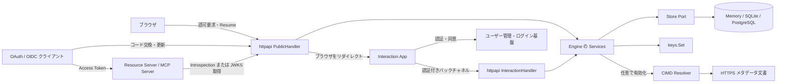
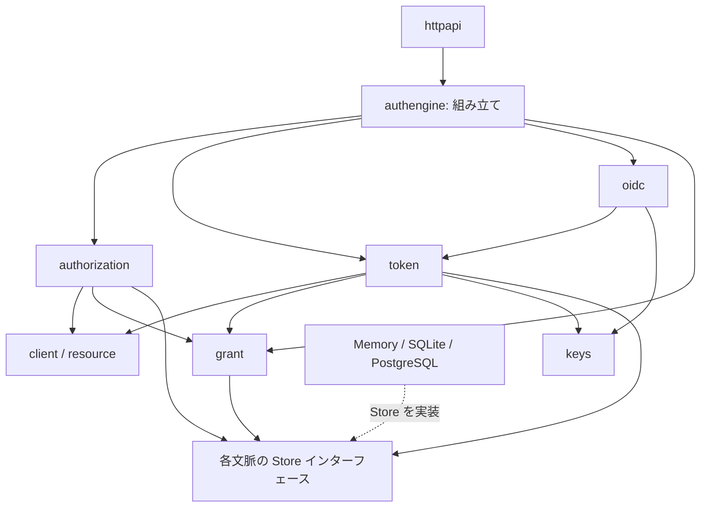
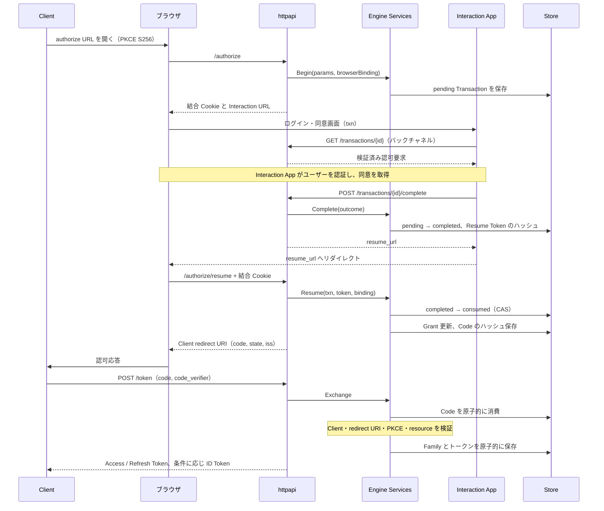
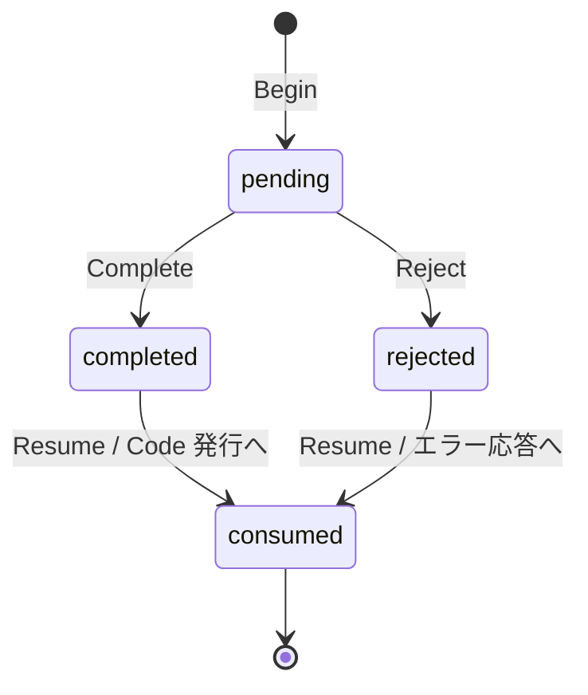
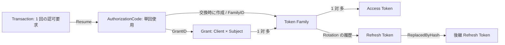
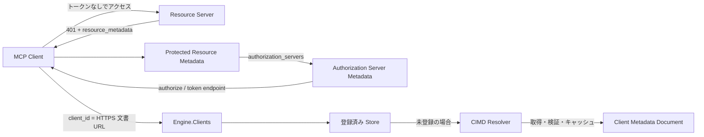

# Architecture

auth-engine は、アプリケーションに組み込む Go 製のヘッドレス OAuth 2.0 / OpenID Connect Protocol Engine である。ログインと同意の判断を外部の Interaction App に委ね、認可要求の検証、認可コードの交換、トークンの発行・失効を担当する。

この文書は **2026-10-25 時点の M3 実装**を対象に、全体像から処理フロー、状態管理、コードの入口へ読み進めるための案内である。図は論理的な責務と呼び出しを示すもので、別プロセスへの分割を必須としない。設計の理由は [ADR 一覧](README.md)、導入方法は [組み込みガイド](embedding.md) を参照する。

## 目次

- [1. システム全体像](#system-context)
- [2. パッケージと依存関係](#packages)
- [3. 起動時の組み立て](#composition)
- [4. HTTP と信頼境界](#http-boundaries)
- [5. Authorization Code フロー](#authorization-flow)
- [6. 状態とデータモデル](#state-model)
- [7. トークン発行・更新・失効](#token-lifecycle)
- [8. MCP と Resource Server](#mcp)
- [9. 永続化と並行処理](#storage)
- [10. 運用上の責務と実装範囲](#operations)
- [11. コードを読む順序と検証](#reading-guide)

<a id="system-context"></a>
## 1. システム全体像



エンジンはユーザーのパスワードやログインセッションを管理しない。Interaction App が認証結果の `subject`、認証時刻、許可した scope、Claims を渡す。エンジンはその結果を信頼しつつ、要求 scope の範囲内か、`max_age` を満たすかなどのプロトコル上の条件を検証する。

`resourceserver` は保護される API 側に組み込むライブラリであり、`Engine` が起動するサーバーではない。デモでは認可サーバーと Interaction App を同一プロセスに置けるが、論理的な境界は保たれる。

実装参照: [Engine と Config](../engine.go)、[HTTP Handler の分離](../httpapi/server.go)、[認証結果の検証](../authorization/service.go)、[デモの配線](../examples/standalone/cmd/server/main.go)。

<a id="packages"></a>
## 2. パッケージと依存関係

汎用的な `domain / usecase / protocol` の階層ではなく、認可・トークン・クライアントなどの文脈ごとに型と処理をまとめている。永続化インターフェースは使う側が定義し、ルートの `Store` がそれらを合成する。

| パッケージ | 主な責務 | 読み始めるファイル |
| --- | --- | --- |
| ルート `authengine` | 設定検証、依存の組み立て、Store の合成 | [engine.go](../engine.go)、[store.go](../store.go) |
| `httpapi` | HTTP 入出力、Cookie、エラー変換、2 種の Handler | [server.go](../httpapi/server.go) |
| `client` | Profile、redirect URI、scope、クライアント解決 | [profile.go](../client/profile.go)、[store.go](../client/store.go) |
| `authorization` | Begin / Complete / Reject / Resume、PKCE、Transaction | [service.go](../authorization/service.go) |
| `grant` | Client × Subject の認可記録、統合、連携解除 | [grant.go](../grant/grant.go)、[service.go](../grant/service.go) |
| `token` | Code 交換、Refresh Rotation、M2M、検査・失効 | [service.go](../token/service.go)、[store.go](../token/store.go) |
| `oidc` | ID Token、scope に応じた UserInfo | [idtoken.go](../oidc/idtoken.go)、[userinfo.go](../oidc/userinfo.go) |
| `keys` | 署名鍵セット、JWT 署名・検証、公開 JWKS | [keys.go](../keys/keys.go) |
| `resource` | 静的 Resource 設定、URI 正規化、scope と形式の制約 | [resource.go](../resource/resource.go) |
| `cimd` | HTTPS 文書からの MCP Client 解決、キャッシュ、SSRF 対策 | [resolver.go](../cimd/resolver.go) |
| `resourceserver` | Bearer 検証、audience / scope 検査、保護対象の Discovery | [protector.go](../resourceserver/protector.go) |
| `storage` | 共通エラー、Memory Adapter、Store 契約テスト | [storagetest.go](../storage/storagetest/storagetest.go) |



図は主要な依存の抜粋である。`token` は `oidc` を直接 import せず、`token.IDTokenIssuer` を呼ぶ。`oidc.IDTokenIssuer` を Engine が注入するため、循環依存を避けながら OIDC を接続できる。

ルート、SQLite、PostgreSQL、standalone、E2E tests は別 Go Module で、[go.work](../go.work) に束ねられている。コアの外部依存は [go-jose/v4](../go.mod) のみで、DB ドライバーと goose は各 Adapter 側に閉じる。判断の背景は [ADR-0007](adr/0007-package-layout.md)。

<a id="composition"></a>
## 3. 起動時の組み立て

`authengine.New(Config)` が依存の組み立ての入口になる。

1. Issuer、Store、TTL、署名鍵を検証する。RS256 の署名鍵は必須で、JWT を発行する Resource が要求するアルゴリズムも確認する。
2. `resource.NewSet` で Resource 設定を検証・正規化する。
3. Clock と Logger を決定する。テストでは `Config.Now` に時刻取得関数を注入できる。
4. Client Resolver を構成する。通常は Store、CIMD 有効時は `ChainResolver{Store, CIMD}` とする。
5. Authorization、Token、Grants、IDTokens、UserInfo の各 Service に依存を渡す。Access Token の発行には `token.ByFormat` で Opaque / JWT の実装を配線する。

その後、ホストアプリケーションが `httpapi.New` に Engine、Interaction URL、Interaction 認証方式を渡し、返された Handler を HTTP サーバーに mount する。Engine 自体はポートを listen せず、環境変数や設定ファイルも読み込まない。

実装参照: [New](../engine.go)、[HTTP Config](../httpapi/server.go)、[IDTokenIssuer インターフェース](../token/idtoken.go)、[Access Token Issuer](../token/issuer.go)。

<a id="http-boundaries"></a>
## 4. HTTP と信頼境界

| Handler | エンドポイント | 呼び出し元・役割 |
| --- | --- | --- |
| Public | `GET/POST /authorize`、`GET /authorize/resume` | ブラウザによる認可開始と再開 |
| Public | `POST /token` | Profile に応じたクライアント認証と Grant 処理 |
| Public | `POST /revoke`、`POST /introspect` | トークン失効・検査。Introspection は confidential Client の認証が必要 |
| Public | `GET/POST /userinfo` | Access Token による Claims 取得 |
| Public | `GET /jwks`、`GET /.well-known/oauth-authorization-server`、`GET /.well-known/openid-configuration` | 公開鍵とメタデータ |
| Interaction | `GET /transactions/{id}` | ログイン・同意 UI に必要な要求内容を取得 |
| Interaction | `POST /transactions/{id}/complete`、`POST /transactions/{id}/reject` | 認証・同意結果をバックチャネルで通知 |
| Interaction | `GET /grants` | Subject の認可記録を参照 |

Interaction Handler は全ルートで `InteractionAuthenticator` を通す。組み込みの `BearerAuthenticator` は共有 Bearer Token を使用する。これはエンドユーザーのログイン認証とは別の、Interaction App 自体を信頼するための境界である。

Public Handler という名称は「全操作が匿名で使える」という意味ではない。トークン操作には Client 認証や Bearer Token 検証がある。Grant の連携解除は `Engine.Grants.Revoke` で行い、現在の Interaction Handler に削除用 HTTP ルートはない。

実装参照: [ルーティング](../httpapi/server.go)、[Interaction 認証と API](../httpapi/interaction.go)、[Grant Service](../grant/service.go)。JSON 契約は [Interaction API 仕様](interaction-api.md)。

<a id="authorization-flow"></a>
## 5. Authorization Code フロー



`Complete` は認証結果の記録にとどまり、認可コードを返さない。`Resume` が Resume Token とブラウザ結合 Cookie の両方を検証してからコードを発行するため、Interaction App にコードを渡す必要がない。拒否時も `Reject → Resume` を経由し、Client にプロトコルエラーを返す。

書き込み順序は失敗時に再利用を許さない設計になっている。Resume は Transaction を先に消費し、その後 Grant と Code を作る。コード交換も Code を先に消費し、その後の PKCE 検証などで失敗しても未消費には戻さない。途中障害時には、同じ要求の再試行ではなく認可のやり直しが必要になる場合がある。

実装参照: [HTTP 認可処理](../httpapi/authorize.go)、[Begin / Complete / Reject / Resume](../authorization/service.go)、[結合 Cookie](../httpapi/cookie.go)、[exchangeCode](../token/service.go)。

<a id="state-model"></a>
## 6. 状態とデータモデル



期限切れは独立した Status ではなく `ExpiresAt` で判定する。状態遷移の正当性は `Status.CanTransitionTo`、競合時に一度だけ成功させる保証は Store の CAS が担う。



この図は論理的な参照関係であり、すべてが DB 外部キーという意味ではない。特に CIMD Client は Store に登録されていなくてもよい。

| モデル | 保持する内容と意味 |
| --- | --- |
| Transaction | 検証済み要求、ブラウザ結合ハッシュ、認証結果または拒否、Resume Token ハッシュ |
| AuthorizationCode | Client、redirect URI、PKCE、認証情報、scope、認可済み resource、発行予定 FamilyID |
| Grant | Client × Subject の認可記録。active な既存 Grant には scope を和集合で追加し、Claims は最新値に置換 |
| Family | 1 回の Code 交換または M2M 要求から派生するトークン群。scope / audience の上限と元の認証情報 |
| AccessToken | その発行に適用された scope / audience、期限、失効状態、トークンのハッシュ |
| RefreshToken | Family への参照、active / rotated / revoked、後継ハッシュ、期限 |

Grant の scope が後の同意で増えても、既存 Family の scope が自動的に増えるわけではない。UserInfo は Grant の最新 Claims スナップショットを読み、提示された Access Token の scope で絞る。ID Token は認証情報を表し、現在の Code フローでは `profile` / `email` などの属性は UserInfo から返す。

実装参照: [Transaction と Code](../authorization/transaction.go)、[Grant.Merge](../grant/grant.go)、[トークンモデル](../token/token.go)、[UserInfo](../oidc/userinfo.go)、[ID Token](../oidc/idtoken.go)。

<a id="token-lifecycle"></a>
## 7. トークン発行・更新・失効

### Profile が許可するフロー

| Profile | Client 認証 | Grant Type | PKCE | Refresh / ID Token |
| --- | --- | --- | --- | --- |
| Web | Secret Basic / Post | Code、Refresh | S256 必須 | あり / `openid` 付与時 |
| Native・CLI | none | Code、Refresh | S256 必須 | あり / `openid` 付与時 |
| Machine | Secret Basic / Post | Client Credentials | 対象外 | なし / なし |
| MCP | none | Code、Refresh | S256 必須 | あり / `openid` 付与時 |

Machine はユーザーとの対話を経ず、`subject = client_id` の Grant と Family を作る。MCP は認可要求に `resource` を必須とする。Custom Profile を設けず、フロー・認証方式の組み合わせを固定することで、設定の自由度を制限している。

### Refresh Rotation

Refresh 要求では Client と Family の対応を検査し、Store の `RotateRefreshToken` で旧トークンの消費、後継 Refresh Token、新しい Access Token の保存を一操作にする。rotated なトークンの再提示を検知すると Family 全体を失効させる。同じ Grant に属する別 Family は維持する。

scope と resource の縮小は今回の Access Token にだけ適用する。Family の上限と後継 Refresh Token の権限は変わらないので、次回は再び Family の上限内で要求できる。絶対期限は既定 30 日、スライド期限は 14 日で、Rotation しても絶対期限を超えない。

### 失効の範囲

| 操作・事象 | Store 上で失効させる範囲 |
| --- | --- |
| Access Token を revoke | その Access Token のみ |
| Refresh Token を revoke | 所属 Family と配下の全トークン |
| Refresh Token の再利用 | 所属 Family と配下の全トークン |
| 消費済み Code の再提示 | Code が参照する Family（存在する場合） |
| `Grants.Revoke` | Grant と全 Family・全トークン |

Code 消費と Family 作成は別操作なので、同時交換の敗者による失効が勝者の Family 作成より先に走ると、その Family を失効できない窓がある。現実装はこの制約を `revokeFamilyOnReuse` に明記している。また ID Token の生成は Access / Refresh Token の保存後なので、署名失敗で全処理がロールバックされるわけではない。

### Opaque と JWT

| 形式 | 検証経路 | 失効の伝播 |
| --- | --- | --- |
| Opaque（既定） | `/introspect`、同一プロセスなら `Engine.Token.Inspect` | Store の状態を問い合わせて判定 |
| JWT（Resource ごとの設定） | JWKS によるローカル検証、または Introspection | ローカル検証だけでは Store の失効を即時には検知せず、`exp` まで有効になり得る |

JWT Access Token もハッシュと状態を Store に保存する。`typ: at+jwt`、Resource を指す `aud` を持ち、Client を `aud` とする ID Token とは用途が異なる。resource を指定しない場合は Opaque となる。

実装参照: [Profile](../client/profile.go)、[M2M](../token/clientcredentials.go)、[Rotation](../token/refresh.go)、[Revoke](../token/revoke.go)、[Introspection](../token/introspect.go)、[JWT 発行](../token/jwt.go)、[Code 再利用の制約](../token/service.go)。

<a id="mcp"></a>
## 8. MCP と Resource Server

MCP 対応は、Client の動的な解決、Resource の明示、Resource Server 側の発見・検証を組み合わせて実現している。



`Engine.Clients` は Store を優先し、未登録なら CIMD で解決する。CIMD は成功した結果をメモリにキャッシュするが、Client を DB に登録する DCR ではない。Client を取得する処理は Store を直接読むと CIMD Client を扱えないため、Resolver を使う。

CIMD の既定 Transport は接続先 IP の検査で SSRF を抑止し、Resolver はリダイレクトを追従しない。取得には既定 5 秒・5 KiB の制限がある。独自 HTTP Client を注入する場合、接続先の安全性はその Transport の責務となる。TrustPolicy は URL の受理方針であり、既定は `AllowAll` である。

Resource は `Config.Resources` の静的一覧だけを受理し、未知のものは `invalid_target` にする。Code から Family、Access Token へと認可済み audience の上限を引き継ぎ、トークン要求ではその範囲内に絞る。複数 Resource を同じトークンに指定する場合は、Opaque / JWT の形式が揃っていることを検査する。JWT の署名アルゴリズムは先頭の Resource 設定から選ばれ、Resource 間でのアルゴリズム一致は検査しない。

Resource Server の `Protector.Require` は TokenVerifier の結果について自分の audience、期限、必要 scope を検査し、成功時は `Principal` を context に渡す。IntrospectionVerifier と JWTVerifier を選べる。トークンなし・無効・audience 不一致は 401、scope 不足は 403、検証基盤の障害は 503 と区別する。

実装参照: [Resolver の連鎖](../client/store.go)、[CIMD](../cimd/resolver.go)、[SSRF 対策](../cimd/ssrf.go)、[Resource.Set](../resource/resource.go)、[Protector](../resourceserver/protector.go)、[JWTVerifier](../resourceserver/jwt.go)、[IntrospectionVerifier](../resourceserver/introspection.go)。実際の接続例は [MCP 相互運用](mcp-interop.md)。

<a id="storage"></a>
## 9. 永続化と並行処理

Store Port は DB の Transaction オブジェクトを Service に公開しない。代わりに、各メソッドが単体で原子的であることを要求する。ユースケース全体を包む単一 DB トランザクションはない。

| Store 操作 | 必要な保証 |
| --- | --- |
| `TransitionTransaction` | 期待する旧 Status が一致した場合だけ遷移する CAS |
| `ConsumeAuthorizationCode` | 一度だけ消費。消費済み Code は期限まで再利用検知用に保持 |
| `IssueTokens` | Grant が active であることの確認と Family / Token 保存を一体化 |
| `RotateRefreshToken` | 旧 Refresh Token の状態確認・更新と後継トークン保存を一体化 |
| `RevokeTokenFamily` | Family と配下トークンをまとめて失効 |
| `RevokeGrant` | Grant と全 Family・全トークンをまとめて失効 |

| Adapter | 原子性の実現 | 用途上の特徴 |
| --- | --- | --- |
| Memory | 単一 Mutex と値の深いコピー | プロセス内のみ。テストや一時的な利用 |
| SQLite | プロセス内書き込み Mutex、`BEGIN IMMEDIATE`、WAL | ファイル DB。プロセス間の書き込みは SQLite のロックで調停 |
| PostgreSQL | DB Transaction、`SELECT ... FOR UPDATE`、条件付き UPDATE | 複数プロセスの競合も DB 側で調停 |

永続 Adapter は SQL マイグレーションを埋め込み、goose をライブラリとして呼ぶ。`Store.Purge` は期限切れデータを掃除する API で、呼び出すスケジューラはホスト側で用意する。

Adapter の互換性は `storage/storagetest.Run` の共通契約テストで検証する。単なる CRUD に加えて、同時 Complete、同時 Code 消費、同時 Rotation、Grant 失効と発行の競合も対象になる。

実装参照: [合成 Store](../store.go)、[Authorization Store](../authorization/store.go)、[Token Store](../token/store.go)、[Grant Store](../grant/store.go)、[Memory](../storage/memory/memory.go)、[SQLite](../adapters/sqlite/sqlite.go)、[PostgreSQL](../adapters/postgres/postgres.go)、[契約テスト](../storage/storagetest/storagetest.go)。

<a id="operations"></a>
## 10. 運用上の責務と実装範囲

| エンジンが提供するもの | ホストアプリケーションが用意するもの |
| --- | --- |
| Protocol Services と HTTP Handler | HTTP サーバー、TLS 終端、公開経路 |
| Interaction 契約とバックチャネル認証フック | ユーザー認証、ログインセッション、同意 UI、認証結果の信頼性 |
| 署名・JWKS・鍵の import / export | 秘密鍵の保管、複数インスタンス間の共有、ローテーション運用 |
| Store Port と Adapter | DB 運用、バックアップ、Purge の実行 |
| `slog` の監査イベント | ログ収集・保存・監視 |
| Resource 設定とトークン検証ライブラリ | Resource 登録、保護対象 API の認可ルールと mount |

既定 TTL は Transaction 10 分、Code 60 秒、ID Token 1 時間。Access Token TTL は Client の設定に従う。JWT をローカル検証する Resource では失効伝播の制約があるため、TTL の設定が運用上の意味を持つ。

現在の対象は Code + PKCE、Refresh、Client Credentials、OIDC Basic OP 関連機能、MCP 連携である。Implicit / Password Grant、Dynamic Client Registration は提供しない。Token Exchange、DPoP、PAR、`private_key_jwt`、RAR は M4 の計画であり、この文書の図に実装済み機能として含めていない。Conformance Suite の実行と規格への完全適合は別で、既存の [検証記録](conformance.md) には PKCE 必須設計による評価上の制約が記載されている。

実装・計画参照: [Config と TTL](../engine.go)、[Client 設定](../client/client.go)、[鍵管理](../keys/keys.go)、[組み込みガイド](embedding.md)、[ロードマップ](roadmap.md)。

<a id="reading-guide"></a>
## 11. コードを読む順序と検証

| 理解したいこと | 推奨する読む順序 |
| --- | --- |
| 全体の配線 | [engine.go](../engine.go) → [httpapi/server.go](../httpapi/server.go) → [HTTP の実行可能な Example](../httpapi/example_test.go) |
| 認可コードができるまで | [request.go](../authorization/request.go) → [authorization/service.go](../authorization/service.go) → [transaction.go](../authorization/transaction.go) |
| トークンのライフサイクル | [token/service.go](../token/service.go) → [refresh.go](../token/refresh.go) → [revoke.go](../token/revoke.go) |
| DB Adapter の追加 | [store.go](../store.go) → [契約テスト](../storage/storagetest/storagetest.go) → [既存 SQLite 実装](../adapters/sqlite/tokens.go) |
| MCP の実装 | [client/mcp.go](../client/mcp.go) → [cimd/resolver.go](../cimd/resolver.go) → [resourceserver/protector.go](../resourceserver/protector.go) |

テストは文脈ごとのユニットテスト、共通 Store 契約テスト、HTTP / Resource Server 統合テスト、別 Module の E2E テストに分かれる。[tests/e2e_test.go](../tests/e2e_test.go)、[tests/lifecycle_test.go](../tests/lifecycle_test.go)、[tests/mcp_test.go](../tests/mcp_test.go) で、複数の文脈をまたぐ動作を読むことができる。

```sh
# リポジトリのルートで実行
go test -run Example ./...   # コア Module の実行可能な使用例
make test                   # 全 Module の go vet + go test -race
make lint                   # 整形、Go バージョン、静的解析、脆弱性、依存境界
```

ルートでの `go test ./...` だけでは別 Module のテストを網羅しない。PostgreSQL Adapter のテストは Docker または指定した PostgreSQL DSN が必要で、DSN 未指定でコンテナを起動できない場合には Skip される。上記は開発時の検証手順であり、この文書を作成した際の実行結果ではない。

実装参照: [Makefile](../Makefile)、[PostgreSQL のテスト初期化](../adapters/postgres/postgres_test.go)、[依存境界の検査](../scripts/check-core-deps.sh)。
