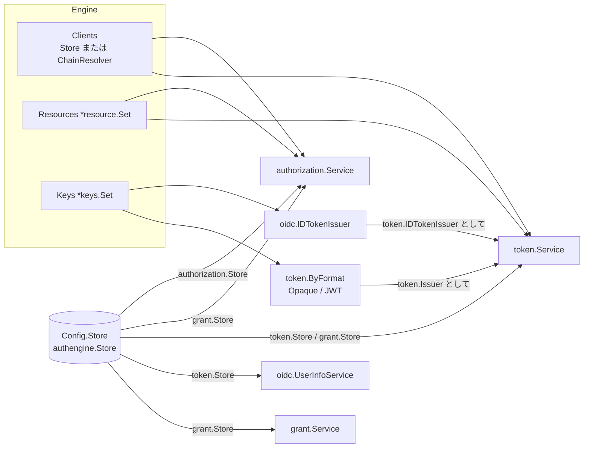

# Day 1 全体像と組み立て

[← 索引](README.md) ｜ [Day 2 →](day2-client-and-request.md)

## 目標

- エンジンが「やること」と「やらないこと」を、HTTP の 2 つの Handler に対応させて説明できる
- `authengine.New` が何を検証し、どの Service に何を渡しているかを追える
- パッケージの依存の向きと、それを機械的に守っている仕組みを説明できる
- 1 回の認可フロー全体を、実行可能な Example で一度通して見たことがある

## この日の用語

| 用語 | 意味 | 出てくる場所 |
| --- | --- | --- |
| ヘッドレス | ログイン・同意の UI とユーザー管理を持たず、プロトコル処理と状態管理だけを担う構成 | ADR-0001、`doc.go` |
| Protocol Engine | auth-engine 本体の呼び名。ルートパッケージ `authengine` の `Engine` がその配線済みの姿 | `engine.go` |
| Interaction App | ログイン・同意画面を持つ外部アプリ。デモでは `loginapp` | ADR-0003 |
| Public Handler | ブラウザ・Client・Resource Server 向けのエンドポイント群（`/authorize` `/token` など）。何も信頼せず、その都度検証する | `Server.PublicHandler` |
| Interaction Handler | Interaction App 専用のバックチャネル API。全ルートが `InteractionAuthenticator` を通る | `Server.InteractionHandler` |
| `InteractionAuthenticator` | Interaction API の呼び出し元を認証する差し替え点。既定は共有トークンの `BearerAuthenticator` | `httpapi/interaction.go` |
| 文脈パッケージ | 層ではなく関心事（client、authorization、token …）で切ったパッケージ。entity と `Service` が同居する | ADR-0007 §1 |
| `Service` | 各文脈のユースケースを実装する構造体。依存はフィールドで受け取り、`Engine` が配線する | `authorization.Service` など |
| Store（Port） | 永続化の口。使う側の文脈がインターフェースを定義する | `token.Store` など |
| 合成 Store | 各文脈の Store を埋め込んだルートの `authengine.Store`。Adapter はこれを実装する | `store.go` |
| Adapter | Store の実装。Memory（テスト用）、SQLite、PostgreSQL | `storage/memory`、`adapters/` |
| センチネルエラー | `errors.Is` で判別する定義済みのエラー値。`storage.ErrNotFound` など | `storage/errors.go` |
| プロトコルエラー / 内部障害 | 前者は型付きのエラー（`authorization.Error` `token.Error`）で 4xx に写す。後者は普通の `error` で 500 | `httpapi/token.go` |
| `Clients`（Resolver） | `client_id` から Client を引く経路。Store だけか、Store → CIMD の `ChainResolver` | `Engine.Clients` |
| Issuer（2 つの意味） | `Config.Issuer` は認可サーバーの識別子 URL（RFC 8414）。`token.Issuer` は Access Token を発行するインターフェース。名前が同じで別物 | `engine.go`、`token/issuer.go` |
| Clock | 現在時刻の取得を差し替え可能にする抽象。期限の判定はすべてこれを通る | `internal/clock` |
| Go Module / go.work | コア、SQLite、PostgreSQL、デモ、E2E の 5 つの Module を `go.work` で束ねる | `go.work` |

## 読む順

1. [architecture.md §1〜§4](../architecture.md#system-context)（システム全体像、パッケージ、起動時の組み立て、HTTP と信頼境界）
2. [ADR-0001 スコープと設計原則](../adr/0001-scope-and-principles.md) と [ADR-0007 パッケージ構成](../adr/0007-package-layout.md) の §1〜§2
3. コード
   - [doc.go](../../doc.go) — ルートパッケージの説明。組み込む側が用意する 4 つのもの
   - [engine.go](../../engine.go) — `Config` `Engine` `New`
   - [store.go](../../store.go) — 合成 Store
   - [httpapi/server.go](../../httpapi/server.go) — `Config` `New` `PublicHandler` `InteractionHandler`
   - [httpapi/example_test.go](../../httpapi/example_test.go) — `Example_authorizationCodeFlow`

## 解説

### 1. 「ヘッドレス」をコードの形で見る

auth-engine は OAuth 2.0 / OIDC の**プロトコル処理と状態管理**だけを持つ。ユーザーのパスワード、ログインセッション、同意画面は持たない。この線引きは、`httpapi.Server` が返す 2 つの `http.Handler` にそのまま現れている。

| Handler | 誰が呼ぶか | 何を信頼しているか |
| --- | --- | --- |
| `PublicHandler()` | ブラウザ、OAuth Client、Resource Server | 何も信頼しない。Client 認証、PKCE、Bearer Token をその都度検証する |
| `InteractionHandler()` | Interaction App だけ | `InteractionAuthenticator` を通った呼び出し元を「ユーザー認証を正しく済ませた主体」として信頼する |

`InteractionHandler` は内側の `ServeMux` 全体を `requireInteractionAuth` で包んでいる。ルートごとに認証を書く形にしないことで、「認証を付け忘れたルート」がそもそも書けない構造になっている。

```go
func (s *Server) InteractionHandler() http.Handler {
	mux := http.NewServeMux()
	mux.HandleFunc("GET /transactions/{id}", s.handleGetTransaction)
	// ...
	return s.requireInteractionAuth(mux)
}
```

エンジンは Interaction App が渡した `subject` や認証時刻を**検証できない**（パスワードを知らないので）。その代わり、プロトコル上の条件（要求した scope の範囲内か、`max_age` を満たすか）は検証する。この「信頼するが、契約は確かめる」という関係が Day 3 の主題になる。

デモ（`examples/standalone`）では両方の Handler を 1 プロセスに置いているが、待ち受けるアドレスは分けている（公開側は `:8080`、Interaction API は `127.0.0.1:8081`）。論理的な境界は、プロセスを分けなくても**リスナーを分ける**ことで保てる。

### 2. 文脈ごとのパッケージと、使う側が定義する Store

パッケージは `domain / usecase / infra` のような層ではなく、**文脈**（client、authorization、grant、token、oidc、keys …）で切っている（ADR-0007 §1）。各文脈には、その文脈の entity・値オブジェクト・`Service`（ユースケース）が同居する。

特徴的なのは Store インターフェースの置き場所である。

```go
// store.go
type Store interface {
	client.Store
	authorization.Store
	grant.Store
	token.Store
	Purge(ctx context.Context, now time.Time) error
}
```

- `authorization.Store` は Transaction と Code の作成・遷移だけ、`token.Store` は Code の消費とトークンの発行・失効だけ、というように、**使う側の文脈**が自分に必要なメソッドだけを定義する
- ルートの `authengine.Store` がそれらを合成し、Adapter はこの合成型を実装する
- 各 Service は合成型を知らない。`authorization.Service.Store` の型は `authorization.Store` である

こうすると、Service のテストでは必要なメソッドだけを持つ偽物を作れるうえ、「token がうっかり Transaction を書き換える」ような文脈をまたぐ操作が型の上で書けなくなる。`storage` パッケージはセンチネルエラーしか持たない葉パッケージで、全員がこれだけを import して `errors.Is` で判別する。

1 つ注意がある。`ConsumeAuthorizationCode` は Authorization Code（authorization の型）を扱うのに `token.Store` にある。CLAUDE.md の規約「文脈をまたぐ Store 操作は、実行する側の文脈のインターフェースに置く」に従った配置で、Code を消費するのはトークンエンドポイントだからである。

### 3. 依存の向きを機械で守る

| 規律 | どこで守っているか |
| --- | --- |
| コアの外部依存は go-jose/v4 だけ | [go.mod](../../go.mod)、[scripts/check-core-deps.sh](../../scripts/check-core-deps.sh)（`make lint` の `deps-check`） |
| JOSE の利用は `keys` に閉じる | `keys` 以外は `keys.Set` の `Sign` / `Verify` / `JWKS` だけを使う |
| `resourceserver` は認可サーバー側に依存しない | 同じスクリプトの後半。`go list -deps ./resourceserver` を検査する |
| コアのテストから Adapter を import しない | Adapter と E2E は別 Module（[go.work](../../go.work)）。Adapter はコアを import するので、逆向きは循環になる |

`check-core-deps.sh` は `go list -deps` で推移的な依存モジュールを列挙し、許可リスト外があれば失敗する。ADR に書いた方針が、CI で落ちる検査になっている点に注目してほしい。

### 4. `authengine.New` を上から読む

`New` は「検証 → 既定値の決定 → 配線」の順に並んでいる。

**検証（失敗すれば起動しない）**

1. `validateIssuer` — https の絶対 URL で、クエリ・フラグメント・userinfo・**パスを含まない**こと。http は localhost / loopback に限る（`AllowInsecureIssuer` で緩和できるが警告ログを出す）。パスを禁じているのは、エンドポイントを Issuer 直下の固定パスに置くためで（`httpapi.PathAuthorize` など）、ADR-0001 の「選ばせない」原則の一例である
2. TTL の上限 — `TransactionTTL` は 1 時間、`CodeTTL` は 10 分（RFC 6749 §4.1.2 が Code の寿命を最大 10 分と推奨）、`IDTokenTTL` は 24 時間まで。Refresh のスライド期限は絶対期限を超えられない
3. `Keys` に **RS256 の署名鍵**があること。OIDC Core §15.1 が RS256 を OP の必須サポートとしているため
4. `resource.NewSet` で Resource 設定を正規化し、JWT Access Token を要求する Resource があれば、その署名アルゴリズムの鍵が `Keys` にあることを確かめる

設定ミスを**最初のリクエストではなく起動時に**検出する、という方針が一貫している。

**既定値の決定**

- `Config.Now` があれば `clock.Func` で包み、なければ `clock.Real`。以後、期限の判定はすべてこの Clock を通る（[internal/clock](../../internal/clock/clock.go)）
- `Logger` がなければ `slog.Default()`

**配線**



この図は architecture.md にない「どの Service が Store のどの面を受け取るか」を示したものである。読むときのポイントは 3 つある。

- **`Clients` は Store とは別のフィールド**である。CIMD を有効にすると `client.ChainResolver{Store, cimd.Resolver}` になり、Store に登録されていない URL 形式の `client_id` も解決できる。Client を引くコードは `Store.GetClient` ではなく必ず `Engine.Clients` を使う（Day 7）
- **`token` は `oidc` を import しない**。`token` パッケージが `IDTokenIssuer` インターフェースを定義し、`oidc.IDTokenIssuer` がそれを実装し、Engine が注入する。`oidc` は `token.Store` を使うので、逆に `token` が `oidc` を import すると循環する
- **Access Token の形式は `token.Issuer` で差し替える**。Engine は `token.ByFormat{Opaque, JWT}` を渡し、`token.Service` は Resource の設定から形式を選ぶ（Day 4）

Engine 自身はポートを listen せず、環境変数も設定ファイルも読まない（ADR-0002）。設定の解釈はホストアプリケーションの仕事で、デモでは [examples/standalone/cmd/server/main.go](../../examples/standalone/cmd/server/main.go) の `run` がそれをしている。

### 5. HTTP 層は薄く保つ

`httpapi` の各 Handler は「パラメータの取り出し → Service 呼び出し → 結果をステータスに写す」だけで、プロトコルの判断をしない。`handleToken` を例に取る。

1. `r.ParseForm()`
2. `clientCredentials(r)` — Authorization ヘッダの Basic とフォームの `client_secret` から資格情報を取り出す。両方あれば `invalid_request`（RFC 6749 §2.3: 複数方式を併用してはならない）
3. `token.Request` を組み立てて `Engine.Token.Exchange` を呼ぶ
4. エラーが `*token.Error` なら RFC 6749 §5.2 の JSON（`invalid_client` は 401、他は 400）、それ以外の `error` は 500

**プロトコルエラーは型付きのエラー、内部障害は普通の `error`** という区別が全パッケージで共通している（`authorization.Error` も同様）。HTTP 層は `errors.As` で型を見るだけでステータスを決められる。

`writeJSON` が常に `Cache-Control: no-store` と `Pragma: no-cache` を付けることも見ておくとよい（RFC 6749 §5.1 がトークン応答に求める）。リダイレクトを返す `redirect` も `no-store` を付ける。

### 6. 秘密値の作り方と保存の仕方

[internal/rand](../../internal/rand/rand.go) は短いが、全体の安全性を支えている。

- `Token(prefix)` — 256 bit の乱数を base64url で返す。接頭辞（`at_` `rt_` `rs_`）はログやシークレットスキャナで種別を見分けるためのもの
- `Hash(secret)` — SHA-256 の 16 進。Store には**これだけ**を保存し、検索キーにもする
- `HashEqual(stored, presented)` — 提示値をハッシュしてから定数時間比較する

元値が 256 bit の一様乱数なので、ハッシュにソルトもストレッチングも要らない（総当たりが成立しない）。パスワードのハッシュとは前提が違う点に注意する。`BearerAuthenticator.Authenticate` も両辺をハッシュしてから比べている。こうすると、長さの違いも比較時間に現れない。

## 手を動かす

### 1. 全体を一度通す

```bash
make vet test
```

### 2. フロー全体を 1 プロセスで見る

```bash
go test -run 'Example_authorizationCodeFlow' -v ./httpapi/
```

出力の番号（1、3、5、7）は [interaction-api.md](../interaction-api.md) の「全体の流れ」の手順番号に対応する。Example のコードを開き、**ブラウザ・Interaction App・Client の 3 役**をこの関数がどの順で演じているかを、手順ごとに書き出してみること。特に、`res.Cookies()` で受け取ったブラウザ結合 Cookie を、手順 7 で送り返している箇所を探す。

### 3. デモサーバーで Discovery を見る

```bash
.claude/skills/run-demo/scripts/demo.sh start -auto-approve
```

起動したら Discovery を取得する。

```bash
curl -s http://localhost:8080/.well-known/openid-configuration
```

`code_challenge_methods_supported` が `S256` だけであること、`response_types_supported` が `code` だけであることを確かめる。これらは設定項目ではなく `httpapi/discovery.go` の `baseMetadata` に固定で書かれている。「実装しないものは広告もしない」が守られているかを見るとよい。

### 4. 起動時検証を予想してから確かめる

`engine_test.go` の `TestNew` を開き、`bad` スライスの各ケースが `New` のどの検査に当たるかを対応づける。そのうえで、`bad` にない次の設定を与えたら `New` が受理するか拒否するかを**予想してから**、テストに足して確かめる。

- `Issuer: "https://user@as.example.com"`
- `Issuer: "https://as.example.com#top"`
- `CodeTTL: 10 * time.Minute`（上限ちょうど）
- RS256 の鍵だけを持つ `Keys` と、`AccessTokenFormat: resource.FormatJWT` で `AccessTokenAlg` を指定しない Resource

### 5. 依存検査を流す

```bash
sh scripts/check-core-deps.sh
```

## 確認問題

1. `InteractionHandler` を `PublicHandler` と同じリスナーで公開してはいけない理由を、「誰が何を信頼しているか」の観点で説明せよ。
2. `token.Service` が ID Token を発行するのに、`token` パッケージが `oidc` を import しないのはなぜか。どういう仕組みで ID Token の発行処理が `token.Service` に届くか。
3. `Engine` に `Store` と別に `Clients` フィールドがあるのはなぜか。`Store.GetClient` を直接呼ぶと何が起きるか。
4. Issuer にパスを含められないのはなぜか。
5. Code やトークンの保存に、bcrypt ではなくソルトなしの SHA-256 を使ってよいのはなぜか。

<details>
<summary>解答</summary>

1. Interaction API の呼び出し元は「ユーザーを認証済み」として信頼され、`subject` を自由に指定して Complete できる。ここに外部から届くと、`InteractionAuthenticator` が唯一の防御になる。ネットワーク上も到達できない位置（内部ネットワーク、loopback）に置き、認証と二重にする前提の設計である（ADR-0003 §4、`httpapi.ExampleNew` のコメント）。
2. `oidc` が `token.Store` や `token.IDTokenInput` を使うため、`token` が `oidc` を import すると循環する。`token` パッケージが `IDTokenIssuer` インターフェースを定義し、`oidc.IDTokenIssuer` がそれを実装し、`authengine.New` が `token.Service.IDTokens` に注入する。インターフェースを使う側に置くことで、依存の向きを `oidc → token` の一方向に保っている。
3. CIMD を有効にすると、URL 形式の `client_id` の Client は Store に存在せず、`cimd.Resolver` がその都度（キャッシュ付きで）組み立てる。`Engine.Clients` は `ChainResolver{Store, cimd.Resolver}` で両方を引ける。`Store.GetClient` を直接呼ぶと CIMD Client は `storage.ErrNotFound` になる（`httpapi.handleGetTransaction` のコメント参照）。
4. エンドポイントを Issuer 直下の固定パス（`/authorize`、`/token` など）に置くと決めているため。パス付き Issuer を許すと、エンドポイントの組み立てやメタデータの well-known URL の位置（RFC 8414 §3）に選択肢が生まれる。ADR-0001 の「選ばせない」原則に従い、組み合わせを減らしている。
5. 元値が 256 bit の暗号学的乱数なので、ハッシュ値から元値を総当たりで求めることは計算量的に不可能である。bcrypt のような遅いハッシュやソルトは、エントロピーの低いパスワードを守るための仕組みであり、ここでは要らない。速いハッシュなので検索キーとしても使える。
</details>
