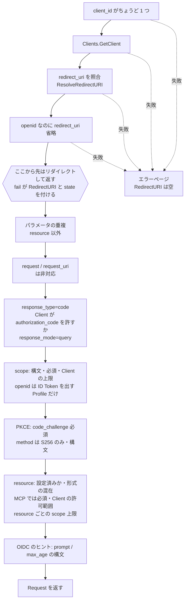

# Day 2 Client Profile と認可要求の検証

[← Day 1](day1-overview.md) ｜ [索引](README.md) ｜ [Day 3 →](day3-transaction.md)

## 目標

- Client Profile が「設定項目を減らす」ためにどう実装されているかを説明できる
- redirect URI の登録時検証と要求時照合の違い、loopback のポート無視がどの Profile にだけ効くかを説明できる
- `parseRequest` の検証順序を、**Client へリダイレクトしてよいエラー / いけないエラー**の境界とともに再現できる
- PKCE（S256）の検証コードを読み、`plain` を受理しないことがどこで保証されているかを示せる

## この日の用語

| 用語 | 意味 | 出てくる場所 |
| --- | --- | --- |
| Client Profile | Web / Native / Machine / MCP の 4 種。grant_type、PKCE、認証方式、redirect URI の照合規則を一括で決める | `client.Profile` |
| 条件表 | Profile ごとの規則を集めた非公開の map。ADR-0004 の表と 1 対 1 で対応する | `profileRules` |
| confidential / public Client | シークレットを安全に保持できるか（RFC 6749 §2.1）。Web と Machine は confidential、Native と MCP は public | `Client.IsPublic` |
| Client Secret | confidential Client の共有シークレット。平文は作成時に 1 回だけ返り、保存はハッシュのみ | `client.Secret`、`SecretHash` |
| redirect URI | 認可応答の返し先。登録時に Profile の規則で検証し、要求時に照合する | `client/redirect.go` |
| 完全一致 | 要求の `redirect_uri` を登録値と文字列で比べる原則（RFC 9700 §4.1.3） | `ResolveRedirectURI` |
| loopback IP リテラル | `127.0.0.1` や `[::1]`。Native と MCP ではポートの違いを許す（RFC 8252 §7.3）。`localhost` は含まない | `loopbackMatch` |
| カスタムスキーム | `com.example.app:/callback` のようなアプリ固有のスキーム。Native だけが使える | `validNativeRedirect` |
| オープンリダイレクタ | 検証していない URL へ利用者を送ってしまう脆弱性。リダイレクトしてはならないエラーがある理由 | RFC 6749 §4.1.2.1 |
| リダイレクト可能なエラー | `client_id` と `redirect_uri` が確定した後のエラー。Client へ `error=...` 付きで返す | `Error.Redirectable` |
| `ErrorRenderer` | リダイレクトできないエラーをブラウザに描く差し替え点 | `httpapi/render.go` |
| scope-token | scope の 1 語の構文。空白・`"`・`\` を含まない印字可能 ASCII（RFC 6749 §3.3） | `ValidScopeToken` |
| PKCE | 認可コードの横取り対策（RFC 7636）。Client が秘密の `code_verifier` を作り、そのハッシュ `code_challenge` を認可要求に載せる | `authorization/pkce.go` |
| S256 | `code_challenge = BASE64URL(SHA256(code_verifier))` の方式。唯一受理する。`plain` は受理しない | `VerifyS256` |
| `state` | Client が CSRF 対策に使う値。エンジンは応答にそのまま返すだけで、Interaction App には見せない | `Request.State` |
| `nonce` | ID Token のリプレイ対策の値（OIDC Core §3.1.2.1）。ID Token に転記する | `Request.Nonce` |
| `prompt` / `max_age` / `login_hint` | OIDC の認証要求のヒント。エンジンは構文だけを確かめ、意味は Interaction App が解釈する | `parseRequest` |
| `UpdateParams` | Client の登録後に変えられる項目だけを持つ入力。ID・Profile・シークレットは含まない | `client/update.go` |

## 読む順

1. [architecture.md §7「Profile が許可するフロー」](../architecture.md#token-lifecycle) の表
2. [ADR-0004 Client Profile](../adr/0004-client-profiles.md)（§1 の表、§2 の開放項目、§4 の変更不可）
3. RFC 6749 §4.1.2.1（エラー応答をリダイレクトしてはならない条件）、RFC 9700 §4.1（redirect URI の完全一致）、RFC 8252 §7.3（loopback）
4. コード
   - [client/profile.go](../../client/profile.go) — `rules` と `profileRules`
   - [client/client.go](../../client/client.go) — `Client`、`NewWeb` / `NewNative` / `NewMachine`、`finish`、`Validate`
   - [client/redirect.go](../../client/redirect.go) — `ResolveRedirectURI`、`validateRedirectURIs`
   - [client/scope.go](../../client/scope.go) と [client/update.go](../../client/update.go)
   - [authorization/request.go](../../authorization/request.go) — `parseRequest`
   - [authorization/pkce.go](../../authorization/pkce.go) と [authorization/errors.go](../../authorization/errors.go)

## 解説

### 1. Profile は「条件表」として実装されている

ADR-0004 の要点は「Client の設定を自由にさせず、用途（Profile）を選ばせる」ことである。実装では、Profile ごとの条件が `profileRules` という 1 つの map に集まっている。

```go
var profileRules = map[Profile]rules{
	ProfileWeb: {
		confidential: true,
		grantTypes:   []GrantType{GrantAuthorizationCode, GrantRefreshToken},
		authMethods:  []AuthMethod{AuthClientSecretBasic, AuthClientSecretPost},
		requirePKCE:  true,
		// ...
	},
	// Native / Machine / MCP
}
```

`rules` 型は**非公開**で、`Client` のフィールドにも grant_type や認証方式の一覧はない。`Client` が持つのは `Profile` だけで、問い合わせはすべて `Allows(gt)` `AcceptsAuthMethod(m)` `IsPublic()` `IssuesRefreshToken()` などのメソッドを経由する。つまり Adapter が保存するのは `profile = "native"` という 1 列だけで、「Native なのに client_credentials を許す」という状態を DB に書くことができない。

この表が ADR の表と一致していることは `client/profile_test.go` の `TestProfileTable` が検証している。**文書の表とコードの表を、テストで 1 対 1 に結びつけている**点が、この実装の「参考実装としてのわかりやすさ」の典型例である。

> **読むときの注意**: `rules.requirePKCE` と `Client.RequiresPKCE()` は定義されているが、本番コードからは呼ばれていない。PKCE は `parseRequest` が**Profile を見ずに全要求で**必須にしている（認可コードを使える Profile はすべて PKCE 必須なので、表の値と矛盾はしない）。表の値は `TestProfileTable` で固定されているが、挙動を決めているのは `parseRequest` の側である。下の「壊して確かめる」で確かめる。

### 2. Client を作る・直す・確かめる

**作る**: `NewWeb` / `NewNative` / `NewMachine` / `NewMCP` の 4 つのコンストラクタだけが入口である。どれも最後に `finish` を呼ぶ。

`finish` の処理:

1. ID が空なら 256 bit の乱数で生成する
2. `applyDefaults` — ID Token を出す Profile で `IDTokenAlg` が空なら RS256。`Resources` を `resource.Normalize` の正規形にそろえる
3. シークレット — confidential で値が与えられれば 32 バイト以上を要求してハッシュ化。与えられなければ生成。public に値が与えられたらエラー
4. `Validate`

シークレットの平文は `client.Secret` として**戻り値でだけ**返り、`Client` には `SecretHash` しか残らない。

**確かめる**: `Validate` はコンストラクタからも、Adapter が DB から復元した値に対しても使える。Profile の規則（scope 構文、redirect URI、confidential ならシークレット必須、TTL の範囲、ID Token の alg）をまとめて検査する。

**直す**（このブランチで追加）: `Client.Update(UpdateParams)` は**新しい `Client` を返し、自分は変更しない**。`UpdateParams` に ID・Profile・シークレット・`CreatedAt` は含まれない。Profile は登録後に変えられないので（ADR-0004 §4）、用途が変われば作り直す。保存は `Store.UpdateClient` で、Adapter は保存済みの Profile との照合と更新を 1 操作で行い、違えば `storage.ErrStateConflict` を返す（Day 6）。

「構築はコンストラクタ、変更は遷移メソッド、フィールドへの直接代入は Adapter だけ」という CLAUDE.md の規約が、ここで初めてはっきり現れる。

### 3. redirect URI: 登録時の検証と、要求時の照合

redirect URI には 2 つの場面がある。

| 場面 | 関数 | やること |
| --- | --- | --- |
| 登録時 | `validateRedirectURIs` | 絶対 URI か、フラグメントがないか（RFC 6749 §3.1.2）、`javascript:` などの禁止スキームでないか、Profile の規則に合うか |
| 要求時 | `Client.ResolveRedirectURI` | 要求の `redirect_uri` を登録済みのものと照合し、**実際に使う URI** を返す |

Profile ごとの登録規則:

| Profile | https | http://localhost | http loopback IP | カスタムスキーム |
| --- | --- | --- | --- | --- |
| Web | 可 | `AllowInsecureLocalhost` のときだけ | `AllowInsecureLocalhost` のときだけ | 不可 |
| Native | 可 | `AllowInsecureLocalhost` のときだけ（RFC 8252 §8.3 で非推奨） | 可 | 可 |
| MCP | 可 | 可（MCP 仕様が localhost を求める） | 可 | 不可 |
| Machine | redirect URI 自体を持たない | | | |

要求時の照合は**完全一致**が原則である（RFC 9700 §4.1.3）。例外は 1 つだけで、Native と MCP の **http loopback IP リテラル**（`127.0.0.1`、`[::1]`）はポート番号の違いを許す（RFC 8252 §7.3。CLI が空いているポートで一時的に待ち受けるため）。`loopbackMatch` はポート以外（ホスト、パス、クエリ）の一致を求める。`http://localhost` はポートも含めて完全一致である点に注意する。

`redirect_uri` が省略された場合は、登録が 1 つだけならそれを使う（RFC 6749 §3.1.2.3）。2 つ以上なら `ErrRedirectURIRequired` になる。

### 4. `parseRequest` の検証順序

`parseRequest` の中心は**検証の順番**にある。RFC 6749 §4.1.2.1 は、`client_id` が不明なときや `redirect_uri` が不正なときに、エラーを Client へ**リダイレクトしてはならない**と定めている。信用できない URI へユーザーを送ると、オープンリダイレクタになるからである。そのため、`client_id` と `redirect_uri` が確定するまでのエラーと、その後のエラーで扱いが分かれる。



実装上の工夫は 2 つある。

- **境界をクロージャで表す**: `redirectURI` が確定した直後に `fail := func(code, desc string) ...` を定義し、以降のエラーはすべて `fail` で返す。`fail` は `RedirectURI` と `State` を埋めるので、境界より後で「リダイレクト不可のエラー」をうっかり返すことがない。逆に境界より前は `&Error{...}` を直接書いている
- **リダイレクトの可否をエラー自身が知っている**: `authorization.Error.Redirectable()` は `RedirectURI != ""` を返すだけである。HTTP 層（`handleAuthorize`）はこれを見て、302 で返すか、`ErrorRenderer` でページを描くかを決める

その他、細かいが意味のある判断:

- 「パラメータは 2 回以上含めてはならない」（RFC 6749 §3.1）を全パラメータに適用し、`resource` だけを例外にする（RFC 8707 は複数指定を許す）
- `request` / `request_uri` は「知らないパラメータとして無視」せず、明示的に `request_not_supported` を返す。署名付き要求を送ったつもりの Client が、無署名で処理されたと気づかないのを防ぐ
- OIDC の要求（`scope` に `openid`）では `redirect_uri` が必須（OIDC Core §3.1.2.1）。これはリダイレクト**不可**の側で判定している。省略された時点では、要求元が本当にその Client かを確かめる手段がないため
- `prompt` `max_age` `login_hint` などは構文だけを確かめ、意味の解釈は Interaction App に任せる（ヘッドレスの原則）。`max_age` だけは Complete のときにエンジンも検証する（Day 3）

### 5. scope の扱い

scope は 3 段階で絞られる。

1. 構文: `client.ValidScopeToken`（RFC 6749 §3.3 の scope-token。空白・`"`・`\` を含まない印字可能 ASCII）。`parseScopes` は重複も除く
2. Client の上限: `Client.DisallowedScopes`。MCP Client で文書に scope がない場合だけは上限なし（Day 7）
3. Resource ごとの上限: `resource.Set.DisallowedScopes`。ただし OIDC の標準 scope（`openid` `profile` …）は制限を受けない（Day 7）

Interaction App が同意で scope を**さらに減らす**のは Day 3 の Complete である。

### 6. PKCE

```go
func VerifyS256(challenge, verifier string) bool {
	if !ValidCodeVerifier(verifier) || !ValidCodeChallenge(challenge) {
		return false
	}
	sum := sha256.Sum256([]byte(verifier))
	computed := base64.RawURLEncoding.EncodeToString(sum[:])
	return subtle.ConstantTimeCompare([]byte(computed), []byte(challenge)) == 1
}
```

- 対応するのは `S256` だけで、`code_challenge_method` が `S256` でなければ認可要求の段階で `invalid_request` になる。`plain` を「受理して後で失敗させる」のではなく、入口で落とす
- `code_verifier` は RFC 7636 §4.1 の構文（43〜128 文字の unreserved 文字）を先に確かめる。構文の悪い値はハッシュ計算に進まない
- 比較は定数時間

PKCE を検証するのはトークンエンドポイント（Day 4）で、ここでは `code_challenge` を Transaction に保存するだけである。

## 手を動かす

### 1. 要求検証のテストを読む

```bash
go test -run 'TestParseRequest' -v ./authorization/
```

`TestParseRequestNonRedirectableErrors` と `TestParseRequestRedirectableErrors` の 2 つのテーブルを並べ、上の図のどの段階で止まっているかを各ケースに書き込む。`TestParseRequestMachineClientCannotAuthorize` が「`unauthorized_client`」ではなく「リダイレクト不可のエラー」を期待している理由を考える（ヒント: Machine は redirect URI を持たない）。

### 2. 壊して確かめる

worktree（[索引](README.md#壊して確かめるについて)）で次の変更を 1 つずつ入れ、`go test ./client/ ./authorization/` を流す。

| 変更 | 落ちるテスト |
| --- | --- |
| `redirectPolicy.ignoresLoopbackPort` に `|| p == redirectWeb` を足す | `client` の `TestWebDoesNotIgnoreLoopbackPort` |
| `profileRules` の Native の `requirePKCE` を `false` にする | `client` の `TestProfileTable/native` と `ExampleNewNative`。**`authorization` のテストは 1 本も落ちない** |

2 つ目の結果を説明すること。PKCE を必須にしているのはどのコードで、`requirePKCE` の値は何のためにあるのか（上の解説 1 の注意書き）。この変更を「安全」と言ってよいかどうかも考える。

### 3. デモでエラーの出し分けを見る

デモサーバーを起動した状態で、次の 2 つの URL をブラウザで開き、片方はエラーページ、もう片方は redirect URI へのリダイレクト（`error=invalid_scope`）になることを確かめる。

```text
http://localhost:8080/authorize?response_type=code&client_id=nope&redirect_uri=http://127.0.0.1/callback&scope=openid
http://localhost:8080/authorize?response_type=code&client_id=demo-cli&redirect_uri=http://127.0.0.1:5555/callback&scope=admin&code_challenge=E9Melhoa2OwvFrEMTJguCHaoeK1t8URWbuGJSstw-cM&code_challenge_method=S256
```

2 つ目で `redirect_uri` のポート（5555）が登録時のもの（ポートなし）と違っても通ることも確認する（Native の loopback）。

## 確認問題

1. `Client` 構造体に `GrantTypes []string` のようなフィールドがないことには、どんな利点があるか。
2. Native Client に `http://127.0.0.1/callback` を登録した。`http://127.0.0.1:61234/callback` と `http://localhost:61234/callback` の要求はそれぞれどうなるか。
3. `parseRequest` で、scope の検証を `client_id` の検証より前に移すと何がまずいか。
4. `scope=openid` を含み `redirect_uri` を省略した要求を、Client へリダイレクトせずにエラーページで返すのはなぜか。登録 URI が 1 つしかない場合でも同じか。
5. `Client.Update` が `*Client` を書き換えずに新しい値を返すのはなぜか。

<details>
<summary>解答</summary>

1. 保存されるのは Profile 名だけなので、Profile が許さない組み合わせ（例: public Client の client_credentials）を DB に書けない。設定の組み合わせ爆発がなく、テスト対象は 4 つの Profile の表だけになる。Profile の規則を変えれば既存の全 Client に一斉に効く。
2. 前者は loopback IP リテラルなのでポートを無視して一致し、要求された URI（ポート 61234 付き）が使われる。後者は `localhost` なのでポートも含めた完全一致が必要で、登録がないので `ErrRedirectURIMismatch`（リダイレクト不可）。さらに Native は `AllowInsecureLocalhost` なしでは `http://localhost` を登録すらできない。
3. scope のエラーは Client へリダイレクトして返すエラーである。リダイレクト先が確定していない段階でそれを判定すると、未検証の `redirect_uri` にユーザーを送るか、本来リダイレクトすべきエラーをエラーページで返すかのどちらかになる。RFC 6749 §4.1.2.1 の順序（まず Client と redirect URI を確定させる）を崩すことになる。
4. OIDC Core §3.1.2.1 は `redirect_uri` を必須としているので、これは要求の誤りである。そして、どこへ返すかを要求自身が示していない以上、エンジンが登録値を推測してリダイレクトするのは避けている。登録が 1 つでも同じ扱い（`TestParseRequestDefaultRedirectAndDedupScopes` の前半）。`openid` のない OAuth 2.0 の要求なら、RFC 6749 §3.1.2.3 に従って登録値を使う。
5. 更新後の値を `Validate` に通し、失敗したら元の値が無傷で残るようにするため。共有されている `*Client` を途中まで書き換えた状態が観測されることもない。永続化対象は「構築はコンストラクタ、変更は遷移メソッド」という規約の、Client 版の遷移メソッドである。
</details>
