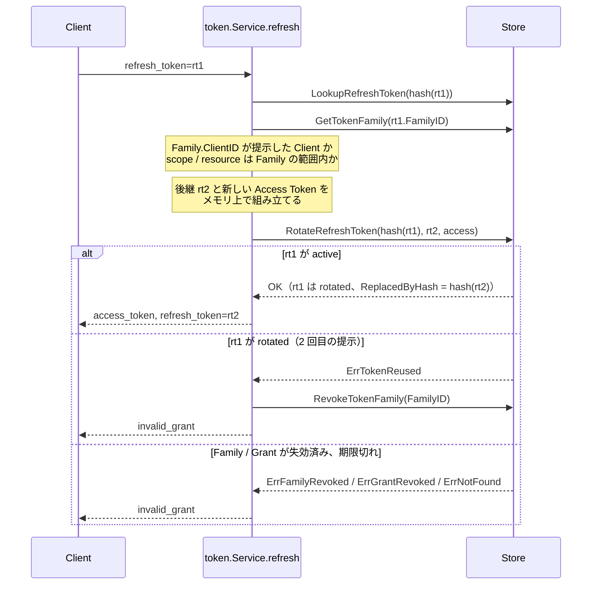

# Day 5 Refresh Rotation、M2M、失効、検査、UserInfo

[← Day 4](day4-code-exchange.md) ｜ [索引](README.md) ｜ [Day 6 →](day6-storage.md)

## 目標

- Refresh Token の Rotation と再利用検知を、シーケンスと Store の戻り値で説明できる
- scope / resource の縮小が「今回の Access Token にだけ効く」ことの意味を説明できる
- client_credentials が Grant と Family をどう作るかを説明できる
- Revocation と Introspection の「失効させる範囲」「誰が呼べるか」「何を返すか」を表にできる
- UserInfo が返す Claims の出所と絞り方を説明できる

## この日の用語

| 用語 | 意味 | 出てくる場所 |
| --- | --- | --- |
| Refresh Token | 新しい Access Token を得るための長寿命のトークン（接頭辞 `rt_`）。発行先の Client に束縛される | `token.RefreshToken` |
| Rotation | Refresh Token を 1 回使うごとに後継と交換すること（RFC 9700 §4.14.2） | `RotateRefreshToken` |
| `active` / `rotated` / `revoked` | Refresh Token の状態。使用前、使用済み（後継あり）、失効 | `RefreshStatus` |
| `ReplacedByHash` | rotated になった Refresh Token が持つ、後継のハッシュ。Rotation の鎖 | `RefreshToken.ReplacedByHash` |
| Refresh Token の再利用検知 | rotated のトークンが再び提示されたら、漏えいとみなして Family 全体を失効させること | `revokeFamilyOnRefreshReuse` |
| 縮小（down-scoping） | Refresh の `scope` / `resource` で、元の範囲より狭いトークンを得ること。今回の Access Token にだけ効き、Family は変わらない | `refresh`、`narrowAudience` |
| client_credentials | ユーザーを介さずに Client 自身がトークンを得る grant（RFC 6749 §4.4）。Machine Profile 専用 | `clientCredentials` |
| M2M | Machine to Machine。サービス間通信。Grant の `subject` は client_id になる | Machine Profile |
| Revocation | トークンを失効させるエンドポイント（RFC 7009、`POST /revoke`） | `Service.Revoke` |
| `token_type_hint` | Revocation / Introspection で、探すトークンの種別を示すヒント。外れていても両方を探す | `lookupOrder` |
| Introspection | トークンの状態を問い合わせるエンドポイント（RFC 7662、`POST /introspect`）。confidential Client だけが呼べる | `Service.Introspect` |
| `active` 応答 | Introspection の結果。不明・期限切れ・失効はすべて `active: false` で、エラーにしない | `Introspection` |
| Inspect / RevokeToken | Introspection と Revocation の Go API 版。Client 認証なしでホストのコードから呼ぶ | `token/introspect.go`、`token/revoke.go` |
| `errNoSuchToken` | 「この種別のトークンではない」を表す内部のエラー。下位の `ErrNotFound` と取り違えないために分けている | `token/revoke.go` |
| UserInfo | Access Token で利用者の Claims を返すエンドポイント（OIDC Core §5.3）。`openid` scope が必要 | `UserInfoService` |
| Claims スナップショット | Complete で Interaction App が渡し、Grant に保存した利用者属性。UserInfo はその最新値を読む | `Grant.Claims` |
| 標準 Claims / 予約 Claims | 前者は scope と対応する属性（`profile` → `name` など）。後者は `iss` `sub` `aud` などエンジンが決める値で、常に除く | `FilterClaims`、`reservedClaims` |
| Bearer Token | 持っているだけで使えるトークン。Authorization ヘッダで送る（RFC 6750 §2.1） | `bearerToken` |
| `WWW-Authenticate` | 401 / 403 の理由を伝えるヘッダ。`invalid_token`、`insufficient_scope` など（RFC 6750 §3） | `bearerError` |

## 読む順

1. [architecture.md §7 トークン発行・更新・失効](../architecture.md#token-lifecycle)（Refresh Rotation、失効の範囲、Opaque と JWT）
2. [ADR-0006](../adr/0006-tokens-and-token-operations.md) の §3〜§5
3. RFC 6749 §6（Refresh）、§4.4（Client Credentials）。RFC 9700 §4.14（Refresh Token の保護）。RFC 7009（Revocation）、RFC 7662（Introspection）。OIDC Core §5.3〜§5.4（UserInfo）、§12（Refresh 時の ID Token）。RFC 6750 §3（Bearer のエラー）
4. コード
   - [token/refresh.go](../../token/refresh.go) — `refresh` `revokeFamilyOnRefreshReuse`
   - [token/clientcredentials.go](../../token/clientcredentials.go)
   - [token/revoke.go](../../token/revoke.go) — `RevokeToken` `Revoke` `revoke` `errNoSuchToken`
   - [token/introspect.go](../../token/introspect.go) — `lookupOrder` `Inspect` `Introspect`
   - [oidc/userinfo.go](../../oidc/userinfo.go)、[oidc/claims.go](../../oidc/claims.go)
   - [httpapi/revocation.go](../../httpapi/revocation.go)、[httpapi/userinfo.go](../../httpapi/userinfo.go)

## 解説

### 1. Refresh Rotation



この図は architecture.md にないもので、`refresh` の処理順と Store の戻り値の対応を示す。

ポイントは 4 つある。

**(1) 判定は Store の 1 操作で行う。** `LookupRefreshToken` の結果で `Status` を見て判断してはいない。Lookup と Rotate の間に別の要求が割り込みうるからである。「active なら rotated にして後継を保存する」までを `RotateRefreshToken` 1 回の原子的な操作にし、その戻り値で分岐する（CLAUDE.md の不変条件「競合は意図を表す 1 メソッドで解く」）。

**(2) 再利用を検知したら Family を失効させ、Grant は残す。** rotated の Refresh Token が再提示されるのは、トークンが漏れて正規の Client と攻撃者の両方が使った兆候である（RFC 9700 §4.14.2）。どちらが正規かはわからないので、その Family 全体（後継の Refresh Token と全 Access Token）を止める。同じユーザーの別のセッション（別の Family）は巻き込まない（ADR-0006 §4）。

`TestConcurrentRefresh` が示すとおり、**正規の Client が同じ Refresh Token を同時に 2 回送った場合も**、敗者は再利用とみなされて Family が失効する。Client の不具合でも安全側に倒す、という判断である。

**(3) 他の Client からの提示は、状態を変えずに拒否する。** `family.ClientID != c.ID` のとき、警告ログを出して `invalid_grant` を返すだけで、Family は失効させない（RFC 6749 §6: Refresh Token は発行先の Client に束縛される）。

**(4) scope と resource の縮小は、今回の Access Token にだけ効く。** `scope` パラメータは Family の scope の部分集合でなければならず（拡大は `invalid_scope`）、`resource` も Family の Audience の部分集合でなければならない。縮小した値は今回の Access Token に付くだけで、`Family` も後継の Refresh Token も元の上限を保つ。次の Refresh では、また Family の上限まで要求できる。

Refresh の応答にも、`openid` があれば新しい ID Token が付く（OIDC Core §12.2）。`auth_time` / `amr` / `acr` は**元の認証**のもので、だから Day 4 で Family に写しておいた。`nonce` は元の認可要求に対する値なので載せない。

### 2. 期限: 絶対期限とスライド期限

- `newRefreshToken` は `min(now + RefreshTokenIdleTTL, Family.ExpiresAt)` を後継の期限にする
- 14 日以内に使い続ければスライド期限は延び続けるが、30 日の絶対期限で必ず止まる（`TestRefreshAbsoluteExpiry`）
- 期限切れの Refresh Token は `RotateRefreshToken` が `ErrNotFound` にする

### 3. client_credentials（Machine Profile）

ユーザーが介在しないので、`clientCredentials` は **`subject = client_id`** の Grant を作る（RFC 6749 §4.4）。

1. `scope` が未指定なら Client に許可された全 scope、指定されたらその範囲内（範囲外は `invalid_scope`）
2. `resource` は設定済みかつ Client の許可範囲内（`clientCredentialsAudience`）。ユーザーの同意がない grant なので、「認可済みの範囲」は Client の登録内容そのものになる
3. `UpsertGrant` — 同じ Client の再要求は既存 Grant を更新する（scope は和集合）。`Grants.Revoke` 済みの Grant も、ここで active に戻る（`TestClientCredentialsRevokedGrantRevives`）
4. 新しい Family を作り、Access Token だけを `IssueTokens` で保存する。Refresh Token と ID Token は出さない

Machine Client はいつでも新しいトークンを取り直せるので、Refresh Token は要らない。要求のたびに Family が 1 つ増える。

### 4. Revocation（RFC 7009）

| 何を失効させたか | 失効する範囲 |
| --- | --- |
| Access Token | そのトークンだけ。同じ Family の Refresh Token は残る |
| Refresh Token | 所属する Family と、配下の全トークン（RFC 7009 §2.1: 同じ grant に基づく Access Token も無効にすべき） |

`token_type_hint` は探索順のヒントにすぎず、外れていても両方の種別を探す（`lookupOrder`）。

`/revoke`（`Service.Revoke`）は Client 認証の後、**その Client に発行されたトークンだけ**を失効させる。他の Client のトークン、不明なトークン、失効済みのトークンに対しても、何もせずに 200 を返す（RFC 7009 §2.2）。「そのトークンは存在するが、あなたのものではない」と教えないためである。

Go API の `RevokeToken`（`owner` が空）は所有者を問わない。管理画面などホスト側の運用から使う。

`errNoSuchToken` は小さいが見どころがある。`revoke` は Access → Refresh と順に探し、`errNoSuchToken` なら次の種別へ進む。Store の `storage.ErrNotFound` をそのまま「この種別ではない」の合図に使わないのは、**下位の `ErrNotFound`**（Refresh Token は見つかったが、参照先の Family がない）を「トークンが存在しない」と取り違えて、黙って 200 にしてしまうのを防ぐためである。不整合は内部エラー（500）として表に出す（`TestRevokeRefreshTokenWithMissingFamilyIsInternalError`）。

### 5. Introspection（RFC 7662）

- 呼べるのは **confidential な Client**（Web / Machine）だけ。public Client は自分を証明できないので `invalid_client`。Resource Server は Machine Profile の Client として登録する想定である
- 認証に通れば、**他の Client に発行されたトークンも**検査できる（Resource Server は任意の Client のトークンを検証するため）
- 不明・期限切れ・失効は、すべて `active: false` で返し、エラーにしない

`Inspect` が `active: true` と判定する条件:

| 種別 | 条件 |
| --- | --- |
| Access Token | `AccessToken.Valid(now)`（active かつ未期限）、かつ Grant が active |
| Refresh Token | Refresh Token が active かつ未期限、Family が active、Grant が active |

Access Token について Family の状態を見ていないのは、Family を失効させるときに配下の Access Token も同じ操作で失効させているからである（Day 6 の `RevokeTokenFamily`）。Grant の状態を**別に**確かめているのは、`LookupAccessToken` が Grant も返す契約にしてあり、Grant の失効チェックを二重にしているためである（[token/store.go](../../token/store.go) のコメント）。

Access Token の `token_type` は `Bearer`、Refresh Token には `token_type` を付けない（RFC 6749 §5.1 の token_type は Access Token の属性なので）。Day 7 で見る `IntrospectionVerifier` は、`token_type` が `Bearer` でないものを拒否するので、Refresh Token を Bearer として Resource Server に持ち込まれても止まる。HTTP 層（`handleIntrospect`）は `iss` を足し、`aud` は常に配列で返す。

### 6. UserInfo（OIDC Core §5.3）

`UserInfoService.UserInfo` の流れ:

1. `LookupAccessToken` で Access Token と Grant を引く
2. Access Token が有効で、Grant が active であること。だめなら `ErrInvalidToken`（401、`error="invalid_token"`）
3. Access Token の scope に `openid` があること。なければ `ErrInsufficientScope`（403、`error="insufficient_scope"`）
4. `FilterClaims(Grant.Claims, AccessToken.Scopes)` に、Access Token の `sub` を足して返す

Claims の出所は **Grant に保存された最新のスナップショット**（ADR-0006 §3）で、絞り込みには **Access Token の scope**（Grant の scope ではない）を使う。Refresh で scope を縮小した Access Token では、返る Claims も減る。

`FilterClaims` の規則:

- OIDC Core §5.4 の標準 Claims（`profile` → `name` など、`email` → `email` `email_verified`）は、対応する scope があるときだけ残す
- 標準外の Claims（Interaction App 独自のもの）はそのまま残す。渡すかどうかは Interaction App が Complete の時点で判断する
- `iss` `sub` `aud` `exp` `nonce` `at_hash` などの**予約 Claims は常に除く**。Interaction App が Claims に `sub` を入れても、エンジンが決めた値で上書きされる

HTTP 層では、Access Token を Authorization ヘッダ（RFC 6750 §2.1）か POST のフォーム（§2.2）で受け取る。両方あれば `invalid_request`。トークンがまったくない要求には、`error` を付けずに `WWW-Authenticate: Bearer realm="userinfo"` だけを返す（RFC 6750 §3.1）。

## 手を動かす

### 1. ライフサイクルのテスト

```bash
go test -race -run 'TestRefresh|TestConcurrentRefresh|TestClientCredentials|TestInspect|TestRevoke|TestIntrospectRequiresConfidentialClient' -v ./token/
```

```bash
go test -run 'TestUserInfo|TestFilterClaims' -v ./oidc/
```

E2E で、発行から失効までをまとめて見る。

```bash
(cd tests && go test -run 'TestOIDCTokenLifecycle|TestRevocationAndIntrospection|TestClientCredentialsFlow' -v .)
```

[tests/lifecycle_test.go](../../tests/lifecycle_test.go) は、Refresh・Revocation・Introspection・UserInfo を HTTP 越しに通している。各段階で使っている Go API（`Engine.Token.Inspect` など）と HTTP エンドポイントの対応を書き出してみること。

### 2. 壊して確かめる

| 変更 | 落ちるテスト |
| --- | --- |
| `refresh` の `s.revokeFamilyOnRefreshReuse(ctx, c, family.ID, now)` の行を消す | `token` の `TestRefreshReuseRevokesFamily`、`TestConcurrentRefresh` |
| `refresh` の `family.ClientID != c.ID` の検査を無効にする | `token` の `TestRefreshInvalid` |
| `Introspect` の `c.IsPublic()` の検査を無効にする | `token` の `TestIntrospectRequiresConfidentialClient`、`httpapi` の `TestRevocationAndIntrospection` |
| `UserInfo` の `openid` の検査を無効にする | `oidc` の `TestUserInfo`、`httpapi` の `TestUserInfoErrors` |
| `FilterClaims` で標準 Claims の scope 判定を無効にする | `oidc` の `TestFilterClaims`、`TestUserInfo` |

2 つ目の変更で `TestRefreshInvalid` が落ちるのは、別の Client（Native の `cli`）から提示した Refresh Token の Rotation が**成功してしまい**、テストが確かめている「トークンは無傷」が崩れるからである。テストの該当箇所を読んで確かめること。

### 3. デモで Rotation と再利用検知を見る

開発者コンソール（`http://127.0.0.1:8083`）でフローを流した後、「Refresh」を 2 回押して Refresh Token が毎回変わることを確かめる。次に、`demo.sh flow` で得た Refresh Token を curl で 2 回使い、2 回目が `invalid_grant` になること、その後は 1 回目の応答で得た新しい Refresh Token も使えなくなっていることを確かめる。

```bash
curl -s -d grant_type=refresh_token -d client_id=demo-cli -d refresh_token=<rt> http://localhost:8080/token
```

サーバーのログに `event=refresh.reuse` が出ることも確かめる。

```bash
.claude/skills/run-demo/scripts/demo.sh logs 50
```

## 確認問題

1. `refresh` が `LookupRefreshToken` で得た `Status` を見て「rotated なら失効」と判断せず、`RotateRefreshToken` の戻り値を見ているのはなぜか。
2. Refresh で `scope=openid` に縮小して得た Access Token で UserInfo を呼ぶと、`profile` の Claims は返るか。その次の Refresh で `scope` を省略すると、Access Token の scope はどうなるか。
3. 他の Client から Refresh Token が提示されたとき、Family を失効させないのはなぜか。失効させる設計と比べた利点と欠点を挙げよ。
4. `/revoke` で他の Client のトークンを指定されたとき、エラーではなく 200 を返すのはなぜか。
5. Introspection が Refresh Token に `token_type` を付けないことは、Resource Server 側の安全性にどう効いているか。

<details>
<summary>解答</summary>

1. Lookup と判断の間に別の要求が同じトークンを Rotation しうるからである。2 つの要求がともに `active` を読めば、両方が後継を発行してしまう。`RotateRefreshToken` は「active なら rotated にして後継を保存」を 1 操作で行うので、勝つのは 1 つだけで、敗者には `ErrTokenReused` が返る。判断の根拠は、原子的な操作の結果だけにする。
2. 返らない。UserInfo は Access Token の scope で Claims を絞るので、`openid` だけなら `sub` と標準外の Claims だけになる。次の Refresh で `scope` を省略すると、Family の scope（元の付与、たとえば `openid profile`）で発行される。縮小は Family を変えないからである。
3. 利点: 攻撃者（または設定を誤った別の Client）が、他人の Refresh Token を送りつけるだけで正規ユーザーのセッションを失効させる、という妨害を防げる。正規の Client は影響を受けない。欠点: その Refresh Token が漏れていることはほぼ確実なのに、Family は生き続ける。代わりに警告ログ（`refresh.client_mismatch`）で検知できるようにしている。
4. RFC 7009 §2.2 の規定で、トークンが無効な場合も成功を返す。他の Client のトークンにエラーを返すと、「そのトークンは存在し、別の Client のものだ」という情報を漏らすことになる。要求した Client から見れば、自分のトークンでないものは無効なトークンと同じ扱いでよい。
5. Resource Server の `IntrospectionVerifier` は `token_type` が `Bearer` でない応答を拒否する。Refresh Token は Introspection で `active: true` になりうるが、`token_type` がないので、Refresh Token を Bearer として API に持ち込まれても Resource Server で止まる。長寿命の Refresh Token が Access Token として使われることを防いでいる。
</details>
