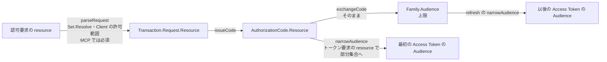

# Day 7 MCP 連携と Resource Server、総まとめ

[← Day 6](day6-storage.md) ｜ [索引](README.md) ｜ [付録 →](appendix-invariants.md)

## 目標

- `resource`（RFC 8707）が認可要求 → Code → Family → Access Token とどう引き継がれ、どこで絞られるかを説明できる
- CIMD の Client 解決の流れと、SSRF 対策がどの層にあるかを説明できる
- `resourceserver.Protector` が返す 401 / 403 / 503 の区別と、`aud` 検査の必要性を説明できる
- Opaque と JWT の Access Token について、検証の経路と失効の伝わり方の違いを説明できる
- この実装に新しい機能を足すとき、どの不変条件に触れるかを判断できる

## この日の用語

| 用語 | 意味 | 出てくる場所 |
| --- | --- | --- |
| MCP | Model Context Protocol。AI のクライアントがツールやデータを持つサーバー（MCP サーバー）に接続するためのプロトコル。認可は OAuth 2.1 系の仕様に従う | ADR-0008 |
| Resource Server | Access Token で保護された API。MCP サーバーもその 1 つ | `resourceserver` |
| resource indicator | トークンを使う先の Resource Server を指す URI。`resource` パラメータで送る（RFC 8707） | `resource.Resource` |
| 正規化 | URI を比較できる形にそろえること。小文字にするのは scheme と host だけで、末尾スラッシュは区別する | `resource.Normalize` |
| `invalid_target` | 未設定・許可範囲外・形式の混在など、`resource` が不正なときのエラー（RFC 8707 §2） | `narrowAudience`、`parseRequest` |
| Access Token の形式 | Opaque か JWT か。Client ではなく Resource の属性で決まる | `Resource.AccessTokenFormat` |
| OIDC の標準 scope | `openid` `profile` `email` など。認可サーバー自身に向けたものなので、Resource ごとの scope 上限の制限を受けない | `oidcScopes` |
| MCP Client Profile | 事前登録なしの public Client。`resource` が必須で、`http://localhost` の redirect URI も許す | `ProfileMCP` |
| CIMD | Client ID Metadata Document。`client_id` を HTTPS の URL にし、その文書から Client を組み立てる。Store には保存しない | `cimd.Resolver` |
| Client Identifier URL | CIMD の `client_id` の形式。https、パスあり、userinfo・フラグメント・ドットセグメントなし | `ParseClientIDURL` |
| `ChainResolver` | 複数の Resolver を順に試す仕組み。Store にあれば優先し、なければ CIMD で解決する | `client/store.go` |
| `ErrUnresolvable` | `client_id` の形式は正しいが、文書の取得や検証に失敗したこと。理由を付けてエラーにする | `client.ErrUnresolvable` |
| TrustPolicy | CIMD の URL を、文書を取得する前に受け入れるか判断する差し替え点。既定は `AllowAll`、許可リストは `HostAllowlist` | `cimd/trust.go` |
| DCR | Dynamic Client Registration（RFC 7591）。Client を動的に Store へ登録する仕組み。実装しない | ADR-0008 §8 |
| SSRF | サーバーに内部ネットワークへの要求を送らせて踏み台にする攻撃。CIMD の取得で問題になる | `cimd/ssrf.go` |
| 特殊用途アドレス | loopback、private、link-local など、外部の文書の取得先として許さない IP の範囲（RFC 6890） | `checkAddress` |
| DNS rebinding | 名前解決の結果を途中で変えて、検査を素通りさせる攻撃。接続の直前にアドレスを検査して防ぐ | `NewTransport` |
| Protected Resource Metadata | Resource Server が自分の情報（`resource`、`authorization_servers`、scope）を公開する文書（RFC 9728） | `Protector.MetadataHandler` |
| `resource_metadata` | 401 の `WWW-Authenticate` に載せる、上の文書の URL。MCP クライアントが認可サーバーを見つける入口 | `Protector.challenge` |
| `Protector` | Resource Server 側でメタデータを配信し、Bearer Token を検証するミドルウェア | `resourceserver.Protector` |
| `TokenVerifier` | トークンの検証方式。`IntrospectionVerifier` と `JWTVerifier` | `resourceserver/verifier.go` |
| `Principal` | 検証済みのトークンが表す主体（`sub`、`client_id`、scope、`aud`）。ハンドラは `FromContext` で取り出す | `resourceserver/verifier.go` |
| `aud` 検査 | トークンが自分宛て（自分の Resource を含む）かを確かめること。無効にする設定はない | `audienceMatches` |
| token passthrough / confused deputy | 受け取ったトークンを別の Resource Server に転用する攻撃。受け取る側の `aud` 検査で防ぐ | MCP 仕様「Token Handling」 |

## 読む順

1. [architecture.md §8 MCP と Resource Server](../architecture.md#mcp)、[§10 運用上の責務](../architecture.md#operations)、[§11 コードを読む順序](../architecture.md#reading-guide)
2. [ADR-0008 MCP 連携](../adr/0008-mcp-integration.md)（§1〜§8 と、末尾の「実装結果」）
3. [MCP 相互運用](../mcp-interop.md)（MCP Inspector との接続記録）
4. コード
   - [resource/resource.go](../../resource/resource.go) — `Normalize` `Set.Resolve` `Set.DisallowedScopes` `oidcScopes`
   - [client/mcp.go](../../client/mcp.go) — `ParseClientIDURL` `NewMCP`、[client/store.go](../../client/store.go) — `ChainResolver`
   - [cimd/resolver.go](../../cimd/resolver.go)、[cimd/ssrf.go](../../cimd/ssrf.go)、[cimd/cache.go](../../cimd/cache.go)、[cimd/trust.go](../../cimd/trust.go)
   - [token/service.go](../../token/service.go) — `narrowAudience`
   - [resourceserver/protector.go](../../resourceserver/protector.go)、[resourceserver/jwt.go](../../resourceserver/jwt.go)、[resourceserver/introspection.go](../../resourceserver/introspection.go)
   - 使用例: [examples/standalone/cmd/mcp-server/main.go](../../examples/standalone/cmd/mcp-server/main.go)
   - E2E: [tests/mcp_test.go](../../tests/mcp_test.go)

## 解説

### 1. Resource は静的設定

Resource Server は `Config.Resources` に列挙したものだけを受理する（ADR-0008 §1）。Store には置かない。Resource Server の追加は配備の変更（ネットワーク経路、証明書、Resource Server 側の設定）を伴うので、実行時に増やす必要がないからである。

`resource.Normalize` の正規化は**最小限**である。

- 絶対 URI で、フラグメントを含まない（RFC 8707 §2）。`https` に限定せず、`urn:` も受理する
- 小文字にするのは scheme と host だけ（RFC 3986 §6.2.2.1）。MCP 仕様が大文字の受理を求めるため
- パスの大文字小文字と**末尾スラッシュは区別する**。`https://mcp.example.com` と `https://mcp.example.com/` は別の Resource

正規化を広げるほど「同じとみなす」範囲が広がり、意図しない Resource にトークンが通る余地が増える。広げない方に倒している。

### 2. resource の引き継ぎと絞り込み



`token.Service.narrowAudience(requested, authorized, scopes)` が、トークンエンドポイントでの絞り込みを一手に引き受ける。

1. **認可済みの値を再検証する**。`Set.Resolve(authorized)` を通し、設定から外された Resource が残っていれば `invalid_target`。設定を変えた後に、古い Code や Family で外した Resource 向けのトークンを出し続けないための fail-closed である
2. トークン要求に `resource` があれば、各値が設定にあり、かつ認可済みの範囲内であること（RFC 8707 §2.2）。範囲外は `invalid_target`
3. 絞った Audience に対して、scope が Resource ごとの上限（`Resource.Scopes`）に収まること。収まらなければ `invalid_scope`

scope の上限には例外がある。`openid` `profile` `email` `address` `phone` `offline_access` は **Resource の上限の制限を受けない**（`resource.oidcScopes`）。これらは Resource Server ではなく認可サーバー自身（UserInfo、ID Token、Refresh Token）に向けた scope で、MCP クライアントが `openid` と Resource 向けの scope を同時に要求できなくなるのを避けるためである（roadmap の M3 タスク 2 の実施結果）。

複数の Resource を 1 つのトークンに載せるときは、Access Token の形式（Opaque / JWT）が揃っていなければならない（`resource.ErrMixedFormats`）。1 つのトークンは 1 つの形式でしか発行できないからである。

### 3. CIMD: URL を client_id にする

MCP クライアントは事前登録なしに接続する。`client_id` を HTTPS の URL にし、その URL で配信される JSON 文書（Client ID Metadata Document）から Client を組み立てる。DCR（RFC 7591 の動的登録）は実装しない（ADR-0008 §8）。CIMD は Store に何も書かない。

`Engine.Clients` は `ChainResolver{Store, cimd.Resolver}` で、順に試す。

1. **Store** — 登録済みの Client。URL 形式の client_id を事前登録してもよい（CIMD §7）。あればそれを優先する
2. **`cimd.Resolver.GetClient`**
   1. `client.ParseClientIDURL` — https、userinfo なし、パスあり、ドットセグメントなし、フラグメントなし。形式外なら `storage.ErrNotFound`（Store だけで解決した場合と区別しない）
   2. キャッシュにあれば返す
   3. `TrustPolicy.Allow` — 取得**前**に URL を受け入れるか判断する。既定は `AllowAll`。ドメインの許可リストは `HostAllowlist`
   4. `fetch` — 取得し、`client.NewMCP(doc, documentURL, now)` で検証する
   5. 成功した結果だけを、`Cache-Control` の `max-age` を [1 分, 24 時間] に収めた期間キャッシュする（CIMD §5.2）

解決に失敗した理由は `client.ErrUnresolvable` に包んで返し、認可要求ではリダイレクトしない `invalid_request`、トークン要求では `invalid_client` に、理由付きで写す（Day 2、Day 4）。

`NewMCP` の検証（CIMD §4）:

- 文書の `client_id` が、取得した URL と**単純な文字列比較**で一致すること。他人の文書を自分の client_id として使わせない
- `client_secret` や共有シークレットの認証方式を含まないこと（CIMD §4.1）。公開 URL の文書にシークレットは置けない
- `grant_types` / `response_types` が Profile の固定値と矛盾しないこと。文書の値で Profile を変えることはない（ADR-0004）
- redirect URI は MCP Profile の規則で検証する（Day 2: https、`http://localhost`、loopback）
- `scope` がなければ、Client の scope 上限を持たない。その場合も Resource ごとの上限は効く

### 4. SSRF 対策

CIMD の Resolver は、**攻撃者が指定した URL に、認可サーバーから HTTP 要求を送る**機能である。内部ネットワークのアドレス（`http://169.254.169.254/` のクラウドメタデータ、`10.0.0.0/8` の社内サービスなど）を client_id にされると、認可サーバーが踏み台になる（CIMD §8.6）。

対策は層になっている。

| 層 | 実装 | 防ぐもの |
| --- | --- | --- |
| URL の形式 | `ParseClientIDURL` が https を要求する | 平文 HTTP での取得 |
| 接続先アドレス | `NewTransport` が `net.Dialer.Control` で、**名前解決の後、接続の直前に** IP を検査する（`checkAddress`） | 特殊用途アドレスへの接続。DNS rebinding（検査した後に別のアドレスへ解決し直す）も、接続そのものを検査するので効かない |
| プロキシ | `Proxy: nil` | プロキシ経由だと接続先を検査できない |
| リダイレクト | `CheckRedirect = noRedirect` | 外部の URL から内部へのリダイレクト |
| 大きさと時間 | 5 秒、5 KiB（上限 + 1 バイトを読んで超過を判定） | 巨大な文書や遅い応答による資源の消費 |
| キャッシュ件数 | 既定 1000 件。期限切れ → 期限の近いものの順に捨てる | 未知の client_id を大量に送ってメモリを使い切らせる攻撃 |

`checkAddress` は `netip` の判定（loopback、private、link-local、multicast、unspecified）に、RFC 6890 の残りの範囲（Shared Address Space、TEST-NET、6to4 など）を足して拒否する。IPv4-mapped IPv6 は `Unmap` してから判定する。

`Config.HTTPClient` を差し替えた場合、リダイレクトの非追従は Resolver が上書きするが、**接続先の検査は Transport の責務**なので、`cimd.NewTransport` を基にしなければ SSRF 対策が外れる（パッケージのコメントと architecture.md §8）。

### 5. Resource Server 側: `resourceserver.Protector`

`resourceserver` は保護される API の側に組み込むライブラリで、認可サーバーのパッケージに依存しない（Day 1 の依存検査）。

`Protector.Require(scopes...)` の判定:

| 状況 | 応答 | 根拠 |
| --- | --- | --- |
| Authorization ヘッダがない | 401。`WWW-Authenticate: Bearer resource_metadata="...", scope="..."`（`error` なし） | RFC 9728 §5.1、RFC 6750 §3.1 |
| ヘッダの形式が不正 | 400 `invalid_request` | RFC 6750 §3.1 |
| トークンが無効（`ErrInvalidToken`） | 401 `invalid_token` | 同上 |
| `aud` に自分の Resource がない | 401 `invalid_token` | MCP 仕様「Token Handling」 |
| 期限切れ | 401 `invalid_token` | |
| scope 不足 | 403 `insufficient_scope`、`scope="必要な scope"` | MCP 仕様「Runtime Insufficient Scope Errors」 |
| 検証方式の障害（認可サーバーに届かない） | 503 | |

**`aud` の検査は必須で、無効にする設定がない**。これがないと、別の Resource Server（あるいは悪意のある MCP サーバー）向けに発行されたトークンを、そのまま受け取ってしまう。トークンを受け取った MCP サーバーが、ユーザーのトークンを別の MCP サーバーに転用する攻撃（confused deputy、token passthrough）を防ぐのは、受け取る側の `aud` 検査である。

401 の `resource_metadata` は、MCP クライアントが認可サーバーを見つける入口になる。クライアントは Protected Resource Metadata（RFC 9728。`MetadataHandler` が `MetadataPath()` で配信）を取り、`authorization_servers` から認可サーバーのメタデータへ進む（architecture.md §8 の図）。

検証が通れば `Principal` を context に載せ、ハンドラは `resourceserver.FromContext` で取り出す。

### 6. 2 つの Verifier と、失効の伝わり方

| | `IntrospectionVerifier` | `JWTVerifier` |
| --- | --- | --- |
| 検証の仕方 | 認可サーバーの `/introspect` に問い合わせる（Resource Server は Machine Client として認証） | JWKS でローカルに署名を検証する |
| 対応する形式 | Opaque と JWT の両方 | JWT だけ |
| 失効 | 即座に反映される | **`exp` まで反映されない** |
| 認可サーバーへの依存 | 要求ごと | JWKS の取得時だけ |
| 主な検査 | `active`、`token_type` が `Bearer`（Refresh Token を拒否） | `alg` の許可リスト（署名の前）、`typ: at+jwt`（ID Token を拒否）、`iss`、`exp`、`nbf`、`sub` と `client_id` の存在 |

`JWTVerifier` の鍵の扱いにも見どころがある。

- 未知の `kid` を見たら JWKS を取り直してもう一度だけ試す（鍵ローテーション直後への対応）。ただし `MinRefresh`（既定 1 分）より短い間隔では取り直さない。未知の kid のトークンを大量に送られても、認可サーバーへの要求が増えないようにするため
- 取り直しに失敗しても、手元に JWKS があればそれで続ける。手元にない場合は失敗させる（fail-closed）
- 呼び出し側の `ctx` が切れただけ（クライアントの切断）の失敗では、再取得の間引きをしない。間引くと、ローテーション直後の正しいトークンを 1 分間拒否してしまう（最近の修正 `2e72d7e`）

どちらを選ぶかは Resource の `AccessTokenFormat` と対応している（Day 4）。JWT を選ぶ Resource では、失効が `exp` まで伝わらない前提で、Client の `AccessTokenTTL` を短くする。

## 手を動かす

### 1. MCP の E2E を読む

```bash
(cd tests && go test -run 'TestMCP|TestCIMD' -v .)
```

`TestMCPClientJWTAndOpaque` は、JWT と Opaque の各形式を `resourceserver` が受理し、別の Resource 向けのトークンは拒否すること、Revocation の反映に差があることを、1 本のテストで見せている。`TestMCPStepUpAuthorization` は、`insufficient_scope` から追加の同意を経て、Grant の scope が和集合になるまでを通している（Day 3 の `grant.Merge`）。

### 2. 壊して確かめる

| 変更 | 落ちるテスト |
| --- | --- |
| `Protector.audienceMatches` の先頭で `return true` する | `resourceserver` の `TestRequire`、`TestJWTVerifier`、`TestIntrospectionVerifier` |
| `JWTVerifier.Verify` の `typ` の検査を無効にする | `resourceserver` の `TestJWTVerifier` |
| `checkAddress` の `addr.IsPrivate()` を外す | `cimd` の `TestCheckAddress`、`TestNewTransportDialControlRejects` |
| `narrowAudience` の「認可済みの範囲内か」の検査を無効にする | `token` の `TestExchangeAudience`、`TestExchangeAudienceErrors` |

### 3. デモで MCP のフローを通す

前の日の起動モードが残っていることがあるので、先に止めてから自動承認モードで起動する。

```bash
.claude/skills/run-demo/scripts/demo.sh stop
```

```bash
.claude/skills/run-demo/scripts/demo.sh start -auto-approve
```

```bash
.claude/skills/run-demo/scripts/demo.sh mcp-flow
```

`start` は認可サーバーに加えて、デモ MCP サーバーと CIMD 文書の配信サーバーも起動する。`mcp-flow` の出力を追い、次の順に進むことを確かめる。

1. MCP サーバーにトークンなしで要求して 401 を受ける
2. `resource_metadata` から Protected Resource Metadata を取る
3. 認可サーバーを見つけ、URL 形式の client_id（CIMD）と `resource` 付きで認可要求を送る
4. 得た Access Token（`eyJ` で始まる JWT。`scope: mcp:read`）で `/mcp` を呼ぶ

> **2026-10-25 時点の注意**: 手順 4 は `mcp: http://localhost:8090/mcp 405`（`server-initiated streams are not supported`）で終わり、`mcp-flow` はエラー終了する。`cli-client` が `/mcp` を GET で呼ぶ一方、M3 タスク 8 で `cmd/mcp-server` を最小の MCP（Streamable HTTP）にした際、GET を 405 にしたためである（[mcp.go](../../examples/standalone/cmd/mcp-server/mcp.go) の `mcpHandler`）。この 405 は `Protector.Protect` の**内側**のハンドラが返しているので、トークンの検証（署名、`aud`、`mcp:read`）は通っている。トークンが不正なら 401、scope 不足なら 403 になることと比べて確かめるとよい。

MCP サーバーの Protected Resource Metadata を直接見ることもできる。

```bash
curl -s http://localhost:8090/.well-known/oauth-protected-resource/mcp
```

### 4. 総まとめ: 変更を設計してみる

次の変更を入れるとしたら、どのパッケージのどの関数を変え、どの ADR を直し、どの不変条件（[付録](appendix-invariants.md)）に触れるかを書き出す。コードは書かなくてよい。

- (a) Web Profile の Client に、シークレットのローテーション（新旧 2 本を一時的に有効にする）を足す
- (b) Refresh Token の再利用を検知したら、Family に加えて Grant も失効させる「厳格モード」を足す
- (c) CIMD で解決した Client をプロセス内キャッシュではなく Store に保存して、複数インスタンスで共有する

(b) は CLAUDE.md の不変条件と正面から衝突する。どう扱うのが正しいか（ADR を書いて方針を変えるのか、モードを足すのか、そもそも足さないのか）も考えること。この実装は「個別フラグを開放しない」方針（ADR-0004）なので、「モードを足す」はそれ自体が論点になる。

## 確認問題

1. 認可要求にもトークン要求にも `resource` を付けずに得た Access Token は、どの Resource Server でも使えるか。認可要求には `resource` を付け、トークン要求では省いた場合はどうか。
2. MCP クライアントが `scope=openid mcp:read` と `resource=https://mcp.example.com` で認可を要求した。Resource の `Scopes` が `["mcp:read", "mcp:write"]` のとき、`openid` は拒否されるか。
3. CIMD の文書に `client_secret` が書かれていたら拒否するのはなぜか。
4. `net.Dialer.Control` で接続先を検査する方式が、「取得前に URL のホスト名を名前解決して IP を確かめる」方式より安全なのはなぜか。
5. Resource Server が `aud` を検査しなかったら、どんな攻撃が成立するか。

<details>
<summary>解答</summary>

1. どちらにも付けなかった場合は使えない。Code の Resource が空なので、Family と Access Token の Audience も空になる。Audience が空のトークンは認可サーバー自身（UserInfo）向けで、形式は Opaque になる。`Protector` は `aud` に自分の Resource を含まないトークンを `invalid_token` で拒否する。認可要求にだけ付けた場合は使える。`narrowAudience` は、トークン要求に `resource` がなければ認可済みの全部（Code の Resource）を Audience にするので、Access Token の `aud` はその Resource になる。
2. 拒否されない。`openid` は OIDC の標準 scope で、Resource ごとの scope 上限（`Resource.Scopes`）の制限を受けない（`resource.oidcScopes`）。`mcp:read` は上限内なので、要求全体が受理される。
3. CIMD の文書は公開の URL で誰でも取得できるので、そこに書かれたシークレットは秘密にならない。共有シークレットによる認証を受理すると、文書を読んだ誰でもその Client になりすませる。MCP Profile の認証方式は `none` だけで、Client の正当性は PKCE と redirect URI の完全一致で担保する（CIMD §4.1）。
4. 事前の名前解決と実際の接続の間で DNS の応答が変わると（DNS rebinding）、検査した IP と接続する IP が別物になりうる。`Dialer.Control` は、実際に接続しようとしているアドレスそのものを接続の直前に検査するので、この隙間がない。リダイレクト先への接続も同じ Transport を通るが、そもそもリダイレクトは追従しない。
5. 攻撃者が運営する（または侵害された）MCP サーバーが、ユーザーから受け取った自分宛ての Access Token を、別の MCP サーバーへの要求にそのまま使える（token passthrough / confused deputy）。受け取る側が「このトークンは自分宛てか」を `aud` で確かめれば、他の Resource Server 向けのトークンは拒否される。
</details>
